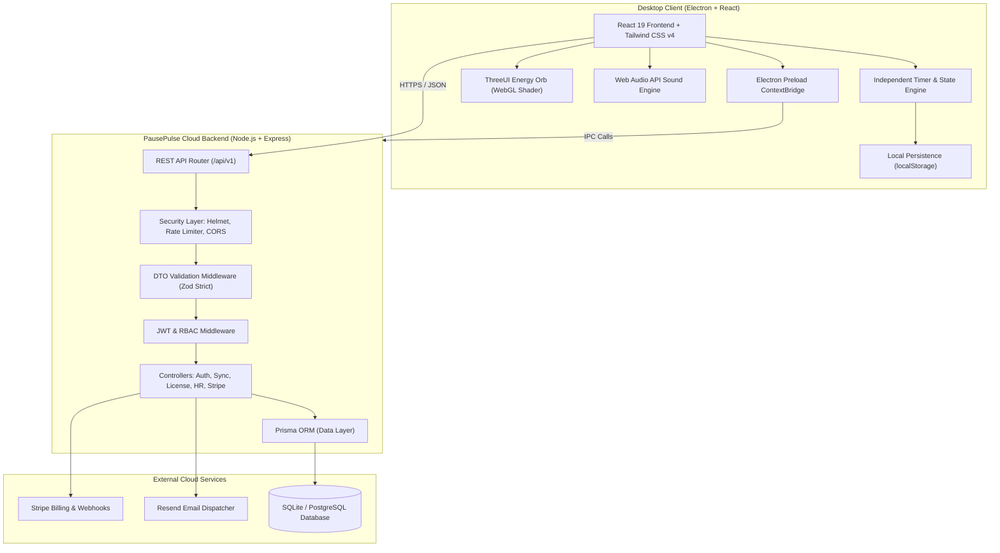
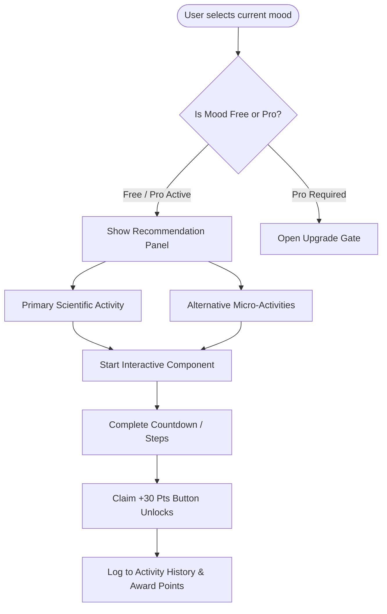

# PausePulse — Comprehensive System Architecture & Product Documentation

---

## 1. Executive Summary & Purpose

### 1.1 What is PausePulse?
**PausePulse** is an ergonomic workplace wellbeing and paced deep-work desktop SaaS application designed for modern knowledge workers, software engineers, and enterprise corporate teams. It combines evidence-based productivity intervals (Pomodoro/focus blocks), physiological micro-break interventions (guided stretching, 20-20-20 eye rest, hydration logging), emotional regulation (targeted mood coaching), neuro-somatic breathing exercises, and an anonymized corporate HR wellness compliance portal.

### 1.2 The Problem
- **Cognitive Exhaustion & Burnout:** Prolonged continuous screen time causes mental fatigue, decision paralysis, and declining productivity.
- **Physical Strain (Musculoskeletal & Eye):** Sedentary desk posture leads to tension headaches, eye strain, repetitive strain injuries (RSI), and dehydration.
- **Fragmented Solutions:** Users typically juggle multiple disconnected tools (a phone timer for Pomodoro, a separate water reminder app, external meditation apps, and no integration with workplace incentives).
- **Enterprise Blindspots:** HR and People Operations teams lack anonymized, non-intrusive data on team wellbeing and break compliance, preventing proactive burnout mitigation.

### 1.3 The Solution & Core Value Proposition
PausePulse solves this through an all-in-one desktop companion:
1. **Paced Focus Execution:** Independent timer tracking for Deep Work, Micro-Breaks, and Lunch with background precision.
2. **Targeted Micro-Interventions:** When a break or emotional drop occurs, targeted micro-activities (15s to 3 mins) restore focus immediately.
3. **Engaging Gamification:** Points, streaks, and tier progression reward consistent healthy habits.
4. **Enterprise Wellness Portal:** Anonymized compliance metrics empower HR teams while respecting individual employee privacy.

---

## 2. System Architecture



---

## 3. Technology Stack & Technical Rationale

| Technology | Layer | Why This Technology Was Chosen |
|---|---|---|
| **Electron** | Desktop Shell | Native desktop integration (tray, global shortcuts, power state monitoring, idle detection), cross-platform deployment (Windows, macOS, Linux) with single codebase. |
| **React 19 & TypeScript** | Frontend UI & State | Industry-standard declarative UI component model; strict end-to-end type safety eliminates runtime null/undefined errors; seamless component lifecycle handling. |
| **Tailwind CSS v4** | UI Styling & Design Tokens | Next-generation performance via `@import "tailwindcss"`; rapid styling with complete CSS custom properties (`--bg`, `--surface`, `--accent`, etc.) supporting light/dark theme tokens. |
| **ThreeUI (`@designcodeio/threeui`)** | 3D Visual Shader | Raw WebGL + Canvas 2D custom Fragment Brownian Motion (FBM) shader that renders the interactive **Energy Orb**. Dynamically responds to breathing rhythms and user focus state with minimal GPU overhead. |
| **Lucide React** | Iconography | Lightweight, consistent SVG icon system with zero layout shift, customizable stroke widths, and accessible markup. |
| **Web Audio API** | Audio Engine | Synthesizes soft binaural and bell frequencies mathematically in-memory using oscillators, without relying on heavy external audio asset downloads. |
| **Node.js & Express.js** | Backend Server | High-throughput, asynchronous event-driven I/O ideal for handling micro-sync operations, license validations, and webhooks with low latency. |
| **Prisma ORM** | Database Layer | Type-safe database queries, automated migrations, declarative schema definition (`schema.prisma`), and frictionless transition from SQLite (dev) to PostgreSQL (production). |
| **Zod** | Validation & DTO Whitelisting | Compile-time and runtime schema validation with `.strict()` enforcement; completely prevents Over-posting and Mass Assignment vulnerabilities. |
| **Helmet** | HTTP Security | Sets standard defensive HTTP headers (Content Security Policy, Anti-Clickjacking `frame-ancestors: 'none'`, `X-Content-Type-Options: nosniff`). |
| **express-rate-limit** | API Throttling | Distributed protection against brute-force attacks on auth, license enumeration, and volumetric DoS. |
| **Stripe SDK** | Billing Engine | Industry gold standard for subscription management (monthly, yearly, enterprise team seats) and cryptographically signed webhooks. |
| **Resend** | Transactional Email | Modern developer-first email delivery infrastructure for sending license keys with zero bounce rate and HTML templates. |

---

## 4. Comprehensive Feature Breakdown

### 4.1 Independent Focus Timer System
- **Three Independent Modes:** Focus (e.g. 25m/custom), Short Break (e.g. 5m/custom), and Lunch Break.
- **Accurate Background Computation:** Computes remaining countdown from `Date.now()` and a saved `endTimestamp` rather than an error-prone `setInterval` counter, ensuring second-precision accuracy even when the operating system throttles background processes.
- **Switch Confirmation Modal:** Prevents accidental cancellation of active sessions. Switching displayed tabs does not reset running timers.
- **Top Bar Indicator:** A live glassmorphic countdown pill at the top of the app continuously displays running session status across all views.

### 4.2 Hydration Tracker
- **Visual Bottle Animation:** Dynamic SVG fluid fill reflecting real-time water percentage against daily target (default 2,000 ml).
- **Quick-Add Actions:** One-click increments (+250 ml, +500 ml).
- **Anti-Cheat Validation:** Throttles excessive repeated manual additions to preserve genuine habits.

### 4.3 Upgraded Mood Coach (9 Moods & Targeted Micro-Activities)
The Mood Coach allows employees to acknowledge their current mental or physical state and immediately receive an evidence-based activity:



#### Supported Moods & Activity Mappings:
1. **Anxious / Stressed** ➔ *Primary:* 3-Phase Box Breathing; *Alt:* Grounding 5-4-3-2-1, Bubble Pop
2. **Physically Tired** ➔ *Primary:* Desk Stretch (6 steps); *Alt:* Eye Rest 20-20-20, Log Water
3. **Mentally Blocked** ➔ *Primary:* Brain Dump (2m timer); *Alt:* Walk Timer (3m)
4. **Isolated / Distant** ➔ *Primary:* Kudos Note (copy message); *Alt:* Gratitude Note (3 things)
5. **Overwhelmed** ➔ *Primary:* Task Triage (Pick 1 Next Step); *Alt:* 3-Phase Breathing
6. **Bored / Lethargic** ➔ *Primary:* Energizer (60s movement); *Alt:* Bubble Pop
7. **Frustrated / Irritated** ➔ *Primary:* Long-Exhale Breathing (4s In / 6s Out); *Alt:* Brain Dump
8. **Eye Strain / Headache** ➔ *Primary:* Eye Rest 20-20-20; *Alt:* Log Water
9. **Feeling Good** ➔ *Primary:* Start Deep Focus; *Alt:* Log Water

#### 10 Self-Contained Interactive Activities:
- **Desk Stretch:** 6 guided 20s steps (Neck Roll, Shoulder Shrug, Chest Opener, Wrist Circles, Seated Spinal Twist, Forward Fold).
- **Eye Rest 20-20-20:** 20s countdown with pulsing ring prompting the user to focus 20 feet away.
- **Grounding 5-4-3-2-1:** Step-by-step sensory prompts (5 see, 4 hear, 3 touch, 2 smell, 1 taste).
- **Brain Dump:** 2-minute timed local-only freewriting space with word count and clear button.
- **Task Triage:** 3-stage prioritization (Dump list ➔ Pick one ➔ Focus mode on that single action).
- **Kudos Note:** Short appreciation composer with character counter and one-click clipboard copy.
- **Gratitude Note:** Three labeled reflections with validation checkmarks.
- **Energizer:** 60-second micro-workout with animated rotating steps.
- **Long-Exhale Breathing:** 4s Inhale ➔ 6s Exhale animated SVG circle activating the parasympathetic vagal brake.
- **Walk Timer:** 3-minute walking interval with rotating posture and environment tips.

### 4.4 Employee Assistance Program (EAP) & Crisis Support
- A discreet **"Need more support?"** modal trigger located at the bottom of the Mood Coach.
- Configurable directly from **Settings** via `eapHelplineUrl` so enterprises can point employees to their company-sponsored mental health provider or national crisis helplines.

### 4.5 Personal Analytics & Focus Score
- Daily breakdown of deep work time, completed breaks, and water intake.
- **Focus Score Algorithm:** Computes an aggregated percentage based on completed cycles and ergonomic compliance.
- **Most Helpful Activities:** Aggregates and ranks the user's completed Mood Coach interventions to highlight what works best.

### 4.6 Gamification & Tier Progression
- **4 Progressive Levels:** Health Novice (Lvl 1), Pacing Pro (Lvl 2), Pro Master (Lvl 3), Wellness Legend (Lvl 4).
- Points awarded for focus completions (+50 pts), breaks (+20 pts), hydration (+10 pts), and mood activities (+30 pts).

### 4.7 Corporate HR Analytics Portal
- **Anonymized Aggregation:** Displays company-wide break compliance, total seats, active employees, and monthly hydration averages without revealing individual activity logs.
- **Enterprise Rewards:** Configurable incentive cards (e.g. coffee vouchers, wellness leave) redeemable via earned points.
- **Live Dark/Light Web Interface:** Accessible directly at `http://localhost:5000/admin`.

### 4.8 Licensing & Commercial SaaS Architecture
- **Tier Gating:** Free Trial (core features), Pro Monthly, Pro Yearly, and Enterprise Team.
- **Cryptographic License Verification:** Activates desktop software via secure server-side validation against database-stored keys (`PP-XXXXXXXXXXXXXXXX`).

---

## 5. Security & OWASP Hardening Implementation

### 5.1 Defense-in-Depth Architecture

```mermaid
flowchart LR
    Request[Incoming HTTP Request] --> Helmet[1. Helmet CSP & Headers]
    Helmet --> CORS[2. Strict CORS Whitelist]
    CORS --> RateLimit[3. express-rate-limit Throttling]
    RateLimit --> BodyLimit[4. 100kb Body Size Limiter]
    BodyLimit --> ZodDTO[5. Zod .strict DTO Whitelisting]
    ZodDTO --> JWTAuth[6. JWT Verification & RBAC]
    JWTAuth --> Controller[7. Business Logic & Field Projection]
    Controller --> ErrorHandler[8. Sanitized Error Handler]
```



### 5.2 Specific Security Remediations Applied
1. **Strict DTO Whitelisting:** Handled by `server/src/middleware/validate.ts`. Every endpoint strictly ignores or rejects unknown fields, preventing Mass Assignment / Over-posting.
2. **Rate Limiting:**
   - `/api/v1/auth/*`: Max 5 requests per 15 minutes (Anti-Brute Force).
   - `/api/v1/license/verify`: Max 15 requests per 10 minutes (Anti-Key-Enumeration).
   - `/api/stripe/create-checkout`: Max 10 requests per 15 minutes.
   - `/api/v1/sync`: Max 60 requests per 15 minutes.
   - Global API: Max 120 requests per 15 minutes.
3. **Environment Security:** `server/src/config/env.ts` strictly validates all secrets using Zod; crashes gracefully in production if `JWT_SECRET` is missing.
4. **Information Leakage Prevention:** Server-side 500 error handlers mask stack traces and raw SQL exceptions, returning safe generic messages to clients.
5. **Admin Dashboard XSS Prevention:** Dynamic employee rewards render through `escapeHTML()` sanitization to block malicious stored payloads.

---

## 6. Database Schema (Prisma ORM)

```prisma
datasource db {
  provider = "sqlite" // production: "postgresql"
  url      = env("DATABASE_URL")
}

generator client {
  provider = "prisma-client-js"
}

enum Role {
  EMPLOYEE
  HR_ADMIN
  SUPER_ADMIN
}

model Company {
  id                 String   @id @default(uuid())
  name               String
  seatCount          Int      @default(10)
  subscriptionStatus String   @default("ACTIVE")
  createdAt          DateTime @default(now())
  updatedAt          DateTime @updatedAt

  users        User[]
  leaderboards Leaderboard[]
  rewards      Reward[]
}

model User {
  id           String   @id @default(uuid())
  companyId    String?
  company      Company? @relation(fields: [companyId], references: [id])
  name         String
  email        String   @unique
  passwordHash String
  role         Role     @default(EMPLOYEE)
  points       Int      @default(0)
  streakDays   Int      @default(0)
  createdAt    DateTime @default(now())
  updatedAt    DateTime @updatedAt

  logs WellnessLog[]
}

model WellnessLog {
  id              String   @id @default(uuid())
  userId          String
  user            User     @relation(fields: [userId], references: [id])
  date            String   // YYYY-MM-DD
  activeMinutes   Int      @default(0)
  idleMinutes     Int      @default(0)
  breaksCompleted Int      @default(0)
  waterIntakeMl   Int      @default(0)
  pointsEarned    Int      @default(0)
  createdAt       DateTime @default(now())
}

model LicenseKey {
  id              String    @id @default(uuid())
  key             String    @unique
  email           String
  plan            String    @default("monthly")
  activatedAt     DateTime?
  expiresAt       DateTime?
  stripeSessionId String?
  createdAt       DateTime  @default(now())
}
```

---

## 7. Getting Started & Deployment Guide

### 7.1 Prerequisites
- **Node.js:** v18.0.0 or higher
- **npm:** v9.0.0 or higher
- **Git**

### 7.2 Running Locally

```powershell
# 1. Clone repository and navigate to folder
cd "C:\Users\Udara\.gemini\antigravity\scratch\pausepulse"

# 2. Install root desktop dependencies
npm install

# 3. Start the Desktop App (Vite Dev Server + TypeScript Watch + Electron)
npm run electron:dev
```

### 7.3 Running the Cloud Backend Server

```powershell
# 1. Navigate to the server directory
cd "C:\Users\Udara\.gemini\antigravity\scratch\pausepulse\server"

# 2. Install server dependencies
npm install

# 3. Initialize SQLite database via Prisma
npx prisma db push

# 4. Start the server in watch mode
npm run dev
```
The server will be available at:
- REST API: `http://localhost:5000/api/v1`
- HR Admin Dashboard: `http://localhost:5000/admin`
- Health Check: `http://localhost:5000/health`

### 7.4 Production Packaging

```powershell
# Compile all layers (Electron, Frontend, Server)
npm run build

# Package desktop installer (.exe for Windows / dmg for macOS)
npm run dist
```
Installers will be generated in the `release/` directory.

---

## 8. Conclusion
PausePulse delivers an enterprise-ready, ergonomically sound, and mathematically paced deep-work ecosystem. By adhering to strict OWASP security standards, responsive WebGL shaders, resilient independent timer architecture, and evidence-based mental wellbeing micro-interventions, the application sets a new benchmark for workplace productivity and employee wellness.
